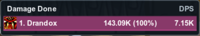

# Party DPS Meter

<!-- drh:show -->
Ranks party members by total enemy damage and shows each player's damage share and DPS. DPS averages five-second windows that start with an enemy hit. Damage to scenery is excluded.

Drag the meter to move it or drag a bottom corner to resize it. The mod saves its layout. **Enable DPS meter** in Settings turns tracking and display on or off. Turning it off clears the current totals. Tracking resumes from zero when enabled again.

Originally part of Mini map & DPS meter, whose map was based on [Xk's Minimap](https://github.com/Xkaka505/DRH-Mod-Minimap). Dungeon Minimap is optional and uses matching player colors.
<!-- /drh:show -->

## Preview

Requires DRH 18 and Mod API 1.4.0 or a compatible later 1.x version. [GPLv3](LICENSE).
